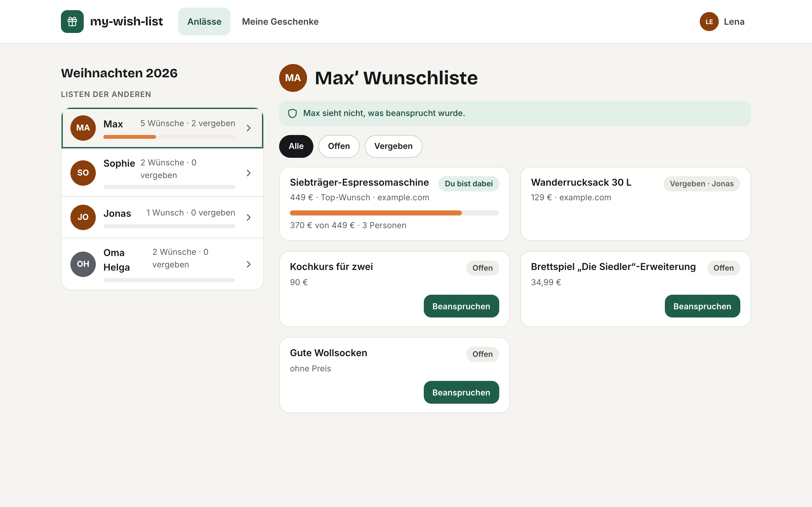
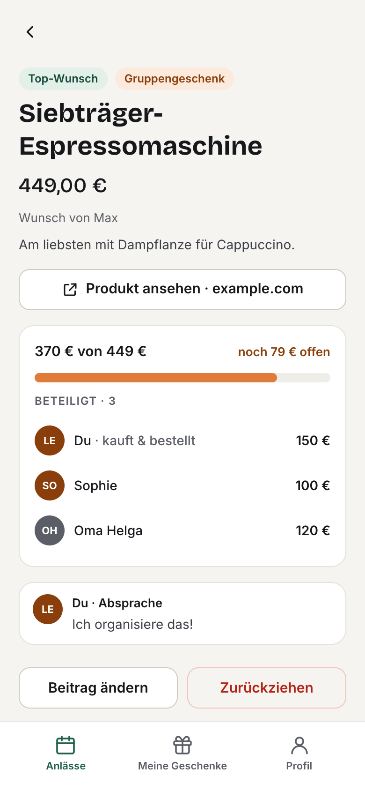
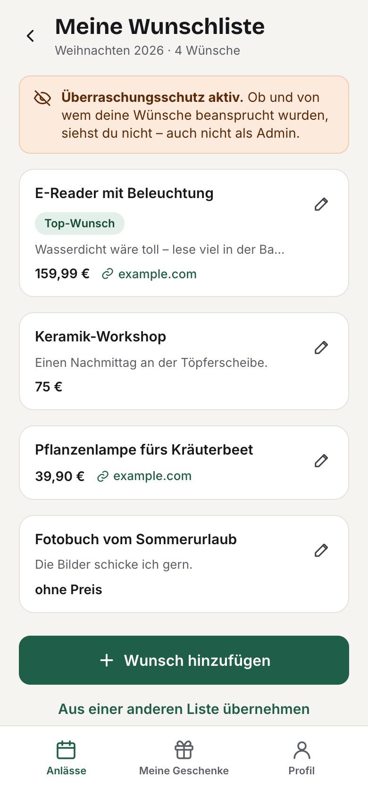

# my-wish-list

Private Wunschlisten-App für Familie und Freunde: Anlässe anlegen, Mitglieder per Username einladen,
Wünsche pflegen, Geschenke beanspruchen oder gemeinsam als Gruppengeschenk finanzieren – ohne dass
die beschenkte Person etwas davon sieht.

- **Frontend:** React 19, TypeScript, Vite, Tailwind CSS v4, TanStack Router (Hash-Routing) & Query, Zod
- **Backend:** Supabase (Free Tier): Postgres mit Row-Level-Security, Supabase Auth, eine Edge Function
- **Hosting:** GitHub Pages, Build & Deploy über GitHub Actions

## Screenshots



<p align="center">
  
  &nbsp;&nbsp;
  
</p>

<sub>Mit Demo-Daten (fiktive Personen) aufgenommen.</sub>

## Inhalt

- [Screenshots](#screenshots)
- [Architektur](#architektur)
- [Sicherheit](#sicherheit)
- [Lokale Entwicklung](#lokale-entwicklung)
- [Supabase einrichten](#supabase-einrichten)
- [GitHub Pages einrichten](#github-pages-einrichten)
- [Tests](#tests)
- [Backups](#backups)

## Architektur

```
Browser (statische SPA auf GitHub Pages)
   │  HTTPS, JWT (Bearer)
   ├──► Supabase PostgREST ──► Postgres  (Lesen per RLS, Schreiben nur über geprüfte RPC-Funktionen)
   ├──► Supabase Auth       (Login mit Username → interne Adresse <username>@users.invalid)
   ├──► Supabase Storage    (Wunschbilder, privater Bucket, signierte URLs, Zugriff per RLS)
   └──► Edge Function "account"
          check-access · register · reset-password · change-password · rotate-recovery · cleanup-images
```

| Pfad | Inhalt |
| --- | --- |
| `src/` | React-App (Seiten in `src/pages`, Datenzugriff in `src/lib/api.ts`) |
| `supabase/migrations/` | Datenbankschema, RLS-Policies, RPC-Funktionen |
| `supabase/functions/account/` | Edge Function für Zugangspasswort, Registrierung, Passwort-Reset, Bild-Aufräumen |
| `supabase/tests/` | Automatische Tests der Zugriffsregeln gegen echtes Postgres |
| `scripts/hash-access-code.mjs` | Erzeugt den Hash für das Zugangspasswort |
| `scripts/backup-db.sh`, `scripts/restore-db.sh` | Daten-Backup und Wiederherstellung der Datenbank (siehe [Backups](#backups)) |

## Sicherheit

**Zugang & Auffindbarkeit**
- Zugangspasswort wird **serverseitig** geprüft (Argon2id-Hash als Secret, Rate-Limit 5 Fehlversuche / 15 Min. pro IP
  und zusätzlich 30 Fehlversuche / 15 Min. global – durch IP-Wechsel nicht umgehbar).
  Ohne gültiges Zugangspasswort ist keine Registrierung möglich; die öffentliche Supabase-Registrierung ist deaktiviert.
- Hinweis: Eine statische Seite auf GitHub Pages kann ihre eigenen Dateien nicht verstecken. Die App-Hülle enthält
  deshalb keinerlei Daten – alle Inhalte gibt es nur mit Login und passenden Datenbankrechten.
- `noindex`/`nofollow`-Meta-Tags, `robots.txt` mit `Disallow: /`, keine Sitemap, keine Social-Previews.

**Konten**
- Username + Passwort, keine E-Mail. Passwort: mind. 12 Zeichen, nicht den Username enthaltend, Buchstaben +
  Zahl/Sonderzeichen, Abgleich mit Have I Been Pwned (k-Anonymität, serverseitig).
- Einmaliger **Wiederherstellungscode** (≈100 Bit, Argon2id-gehasht) statt E-Mail-Reset. Kein Admin-Reset,
  damit niemand fremde Konten übernehmen kann.
- Kurzlebige JWTs mit Refresh-Token-Rotation; Passwortänderung erfordert das aktuelle Passwort.
- Nach einem Passwort-Reset werden **alle** Sessions beendet, nach einer Passwortänderung alle anderen Geräte
  abgemeldet. Bereits ausgestellte Access-Tokens laufen spätestens nach `jwt_expiry` (1 Stunde) ab.

**Datenzugriff (OWASP A01)**
- RLS auf allen Tabellen, Default-Deny. Clients dürfen nur lesen; jede Änderung läuft über
  `SECURITY DEFINER`-Funktionen mit expliziter Rechteprüfung und Validierung.
- **Überraschungsschutz in der Datenbank:** Claims eines Wunsches sind für dessen Owner per Policy unsichtbar –
  auch für Admins, auch über die API.
- Usersuche nur eingeloggt und nur exakte Treffer (keine Enumeration über Teiltreffer).
- **Wunschbilder** liegen im privaten Storage-Bucket `wish-images` (nur WebP/JPEG, max. 1 MiB). Hochladen darf nur
  der Owner in den Ordner seines Wunsches, Ändern/Löschen kein Client. Mitglieder lesen nur das aktuelle Bild eines
  bestehenden Wunsches; ersetzte oder gelöschte Bilder sind sofort nicht mehr abrufbar (bereits ausgegebene signierte
  URLs gelten höchstens noch 1 Stunde). Der Browser verkleinert jedes Bild und kodiert es neu, dadurch werden
  EXIF-/GPS-Daten entfernt. Verwaiste Dateien löscht die Edge Function (`cleanup-images`, rate-limitiert); welche
  Dateien verwaist sind, bestimmt allein die Datenbank.

**Weitere Maßnahmen**
- Strikte Content-Security-Policy (keine Inline-Skripte, nur Supabase als Verbindungs- und Bildquelle), `no-referrer`,
  Frame-Busting gegen Clickjacking (Pages erlaubt keine eigenen Header).
- Kein `dangerouslySetInnerHTML`/`innerHTML` (per ESLint verboten); Produkt-Links nur `https:` mit
  `rel="noopener noreferrer nofollow"`, Prüfung im Client **und** per CHECK-Constraint.
- Keine serverseitigen Abrufe von Nutzer-URLs (kein SSRF).
- Schriftarten selbst gehostet (keine Drittanbieter-Requests).
- CI: `npm audit`, Lint, Typecheck, Unit- und RLS-Tests; Actions per Commit-SHA gepinnt; Dependabot.

## Lokale Entwicklung

Voraussetzungen: Node.js ≥ 22, für das lokale Backend Docker.

```bash
npm install
```

```bash
cp .env.example .env.local   # Werte eintragen
```

```bash
npm run dev
```

Lokales Supabase (optional, braucht Docker):

```bash
npx supabase@3.0.0 start -x realtime,storage-api,imgproxy,mailpit,postgres-meta,studio,logflare,vector,supavisor
```

```bash
npx supabase@3.0.0 functions serve --env-file supabase/functions/.env.local
```

`supabase status` zeigt URL und anon key für `.env.local`.

## Supabase einrichten

1. Projekt auf [supabase.com](https://supabase.com) anlegen (Free Tier, Region z. B. Frankfurt).
2. **Authentication → Sign In / Providers:**
   - „Allow new users to sign up“ **aus** (Konten entstehen nur über die Edge Function)
   - E-Mail-Provider **aktiviert lassen** (wird für den Username-Login gebraucht),
     dort „Confirm email“ **aus**, „Secure password change“ **an**
   - Passwort: Mindestlänge **12**, bei „Password requirements“ **keine** Zeichenklassen erzwingen
     (die Edge Function prüft eigene Regeln; strengere Supabase-Regeln würden gültige Registrierungen ablehnen)
   - Alternativ alles auf einmal aus `supabase/config.toml` übernehmen: `npx supabase@3.0.0 config diff`, dann `config push`
3. Schema einspielen:

   ```bash
   npx supabase@3.0.0 link --project-ref <PROJECT-REF>
   ```

   ```bash
   npx supabase@3.0.0 db push
   ```

4. Zugangspasswort-Hash erzeugen (Eingabe verdeckt):

   ```bash
   node scripts/hash-access-code.mjs
   ```

5. Secrets setzen (Datei nach Vorlage `supabase/functions/.env.example` anlegen, **nicht committen**):

   ```bash
   npx supabase@3.0.0 secrets set --env-file supabase/functions/.env.production
   ```

   - `ACCESS_CODE_HASH` – Ausgabe aus Schritt 4
   - `RATE_LIMIT_SALT` – zufälliger Wert, z. B. `openssl rand -hex 32`
   - `ALLOWED_ORIGINS` – `https://<github-user>.github.io` (ohne Pfad)

6. Edge Function deployen:

   ```bash
   npx supabase@3.0.0 functions deploy account --no-verify-jwt
   ```

> Die Function prüft JWTs selbst; öffentliche Aktionen (Zugang, Registrierung, Reset) brauchen keins.

> `db push` legt auch den privaten Storage-Bucket `wish-images` samt Zugriffsregeln für die Wunschbilder an.
> Nach Änderungen an der Function (z. B. neue Aktion `cleanup-images`) Schritt 6 wiederholen.

## GitHub Pages einrichten

1. Repository → **Settings → Pages → Source: GitHub Actions**.
2. **Settings → Environments → `github-pages`** (entsteht mit Schritt 1):
   - Environment-Variable `VITE_SUPABASE_URL` = `https://<PROJECT-REF>.supabase.co`
   - Environment-Secret `VITE_SUPABASE_ANON_KEY` = anon/publishable Key
     (technisch öffentlich, da er im ausgelieferten JavaScript steht; Schutz erfolgt über RLS)
   - Optional für die Seite „Hinweise & Datenschutz“ (`#/legal`): Variablen `VITE_OPERATOR_NAME`,
     `VITE_OPERATOR_CONTACT` (z. B. E-Mail) und `VITE_DATA_REGION` (z. B. `EU (Frankfurt)`). So stehen keine
     persönlichen Daten im öffentlichen Repository.
3. Push auf `main` → Workflow „CI & Deploy“ testet; der Deploy-Job baut mit diesen Werten und veröffentlicht.
   Fehlt einer der Werte, bricht der Deploy-Job mit einer klaren Meldung ab.

Empfohlen: Branch-Protection für `main` (PR + grüne Checks erforderlich).

## Tests

```bash
npm test          # Unit-Tests (Validierung, Beträge, Wunschbilder)
```

```bash
npm run test:db   # RLS-/RPC-Tests, braucht laufendes Postgres (PGHOST/PGUSER/PGPASSWORD)
```

```bash
npm run lint && npm run typecheck && npm run build
```

## Backups

`scripts/backup-db.sh` sichert die **Daten** der Schemas `public` und `auth` nach `~/Backups/my-wish-list/`
(Dateirechte 600, 30 Tage Aufbewahrung). Schema, Policies, Funktionen und Rechte stecken nicht im Backup, sie kommen
beim Wiederherstellen aus `supabase/migrations/`. Neben jedem Dump liegt `*.migrations.txt` mit dem Migrationsstand.
Nicht gesichert werden Sessions/Refresh-Tokens (ein Restore soll keine widerrufenen Logins wiederbeleben) und
`rate_limits`. Ebenfalls nicht enthalten sind die Edge Function (liegt im Repo), ihre Secrets und die
Projekteinstellungen (siehe [Supabase einrichten](#supabase-einrichten)).

Voraussetzungen: Docker läuft, DB-Passwort im Schlüsselbund:

```bash
security add-generic-password -a "$USER" -s my-wish-list-db -w
```

Backup manuell bzw. als täglichen Job (launchd, 21:00 Uhr) einrichten:

```bash
scripts/backup-db.sh
```

```bash
scripts/install-backup-job.sh
```

**Wiederherstellen:** Erst das Schema auf den Stand aus `*.migrations.txt` bringen (`npx supabase@3.0.0 db push`
bzw. in ein neues Projekt), dann die Daten einspielen. Das Script prüft den Migrationsstand und läuft in einer
Transaktion; schlägt etwas fehl, bleibt die Datenbank unverändert. Danach müssen sich alle neu anmelden.

```bash
scripts/restore-db.sh ~/Backups/my-wish-list/<datei>.dump
```

```bash
scripts/restore-db.sh --replace ~/Backups/my-wish-list/<datei>.dump
```

Ohne `--replace` nur in eine leere Datenbank, mit `--replace` werden die vorhandenen Daten ersetzt. Für ein anderes
Projekt `DB_USER=postgres.<project-ref>` (und ggf. `DB_HOST`, `PGPASSWORD`) setzen.
